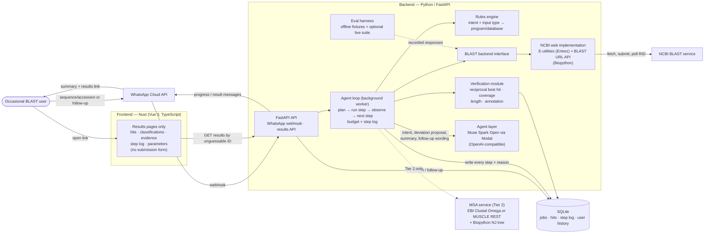
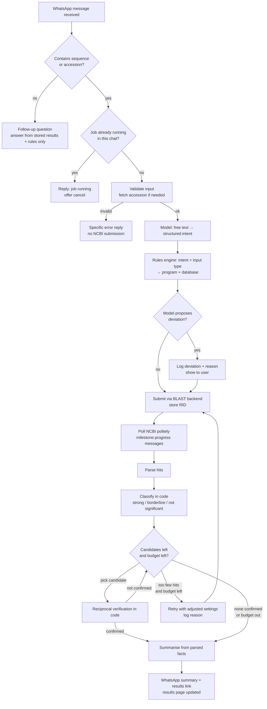

# WhatsGene — Architecture

> Product and science source of truth: `docs/PRD.md` (v0.3) and `docs/blast-rules.md`. Update this file in the same commit as any component or data-flow change (see `AGENTS.md`). Deadline: 4 Nov 2026 MYT. Tier 2 components do not start until Tier 1 works end to end.

## Overview

WhatsGene is **delegate-and-verify**: the user asks once on WhatsApp; the system runs the whole multi-step BLAST workflow itself, verifies hits with deterministic rules, and returns a verified answer with a link to a web results page. WhatsApp chat is the main interface — a message containing a sequence or accession starts a job, other messages are grounded follow-up questions. The web app has **no submission form**; it only renders results pages linked from chat. One backend owns all logic: FastAPI receives WhatsApp webhooks, a background worker runs the agent loop over SQLite, and the Muse model only interprets and explains while code computes and classifies (PRD §3).

## System diagram

Notes: no separate queue service — the worker is a polling loop over SQLite. Hosting must give the backend a public HTTPS URL for the WhatsApp webhook. All config via environment variables, including the Muse endpoint URL and model name, NCBI email/tool, and WhatsApp credentials. The BLAST backend is an interface with one implementation now (NCBI web); local BLAST+ is the post-submission private mode.

## Agent loop and job lifecycle

Job states: `queued → running → done | failed | cancelled`. A job that exhausts its budget ends as `done` with an incomplete outcome (see below), not as a silent failure.

Behaviour rules:

- **One running job per chat.** A new sequence during a run gets a "job running" reply offering cancel; it never silently replaces the running job.
- **Budget:** maximum searches and maximum total time per job, both configurable (defaults: PRD Open questions #1). Every search counts against the budget. On exhaustion, stop and report what was found and what was not.
- **Recovery:** failed or empty searches follow defined paths — next candidate, adjusted-settings retry, or a final report — chosen from observed results and logged. The model words the report; it does not invent a recovery step.
- **Progress:** brief WhatsApp messages at major milestones only (job started, search submitted, hits classified, verification result, done), not every step.
- **Follow-ups:** answered only from stored job results and `docs/blast-rules.md`, quoting actual E-value, identity and coverage. Default target is the latest job; the user may refer to an earlier job. If stored results cannot answer, the reply says so.

## Model vs deterministic code

The model interprets and explains; code computes and classifies. If a value is not in parsed NCBI output, it does not go in any answer.

| Step | Owner |
|---|---|
| Detect sequence/accession in a message; enforce one job per chat | Deterministic code |
| Input validation, DNA/protein detection, accession fetch (E-utilities) | Deterministic code |
| Free-text question → structured intent (goal, organism/group, unclear points) | **Model** |
| Intent + input type → program/database | Rules engine (deterministic, from `blast-rules.md`) |
| Deviation from rules-engine choice | **Model** may propose with stated reason only; deviation is logged and shown (whether it applies automatically or needs confirmation: PRD Open questions #7) |
| BLAST submit, RID storage, polling, parsing | Deterministic code (BLAST backend + worker, Biopython) |
| Significance classification; query coverage from hit coordinates | Deterministic code (thresholds in code/config) |
| Verification: reciprocal best hit, length mismatch, annotation check | Deterministic code |
| Next-step choice in the loop (next candidate / retry / stop) | Agent loop following defined rules over classified, verified facts; every decision logged with its reason |
| Plain-language summary; follow-up answer wording | **Model**, given only parsed hits, classifications, verification verdicts and the rules file; must quote actual values |
| WhatsApp send, retries, results-page rendering | Deterministic code |

## Tier 2 components (in order; gated on Tier 1)

1. **Long-horizon escalation:** when hits are too weak, escalate to PSI-BLAST (NCBI web API support unverified — PRD Open questions #2), then collect confirmed homologs, run an MSA via EBI Clustal Omega or MUSCLE REST (choice open — PRD Open questions #3), and build a neighbor-joining tree with Biopython. Same budget, logging and decision rules as Tier 1. MSA/phylogeny rules come from course decks 06 and 07 when provided; none are invented here.
2. **Research memory:** job history keyed by WhatsApp number in our own SQLite store (never described as a built-in model feature). New results may link to earlier relevant ones (relevance criterion: PRD Open questions #5). A "forget my history" request deletes that user's stored history.

Tier 3 (voice-note questions only; screenshot explanation) is stretch, only if Tier 2 is done by 3 Nov.

## Eval harness

Textbook cases — beta globin NP_000509 vs nematodes, insulin NP_000198 vs *C. elegans*, RBP4 vs CG8 false positives — run offline by default against recorded NCBI responses (fixtures) injected through the BLAST backend interface, so the suite is fast and repeatable. It measures program choice, rejection of false positives, and confirmation of true hits. Tests check behaviour, not exact hit names. A separate live suite against NCBI is optional and never part of the default run.

## Data model

SQLite. Phone numbers are stored server-side only as the history key and are **never** rendered on results pages. Results links use unguessable job IDs.

**Job:** `id` (unguessable, PK) · `whatsapp_user_id` (internal key, never displayed) · `created_at`/`updated_at` · `status` (`queued`/`running`/`done`/`failed`/`cancelled`) · `outcome` (e.g. confirmed / not confirmed / incomplete–budget) · `question` (verbatim) · `intent` (JSON: goal, target organism/group, unclear points) · `input_kind` (`fasta_dna`/`fasta_protein`/`accession`) · `raw_input` · `sequence` (normalised) · `accession` · `query_length` · `detected_type` (`dna`/`protein`) · `program` · `database` · `organism_filter` · `parameters` (JSON, exactly as submitted, per search) · `searches_used` · `deadline_at` · `summary` · `error` · `whatsapp_status` (`not_sent`/`sent`/`failed`, independent of job status) · `notified_at`.

**Search (one per BLAST submission, incl. reciprocal/retry/escalation):** `id` · `job_id` · `kind` (`primary`/`reciprocal`/`retry`/`escalation`) · `program` · `database` · `parameters` (JSON) · `ncbi_rid` · `status` · `submitted_at`/`completed_at`.

**Hit:** `search_id` · rank · accession · organism · % identity · query coverage (computed from hit coordinates) · alignment length · subject length · bit score · E-value · `classification` (`strong`/`borderline`/`not_significant`) · `verification` (reciprocal-best-hit / length / annotation outcomes).

**Step log:** `job_id` · sequence number · timestamp · step · observation · decision · reason · deviation flag + deviation reason where applicable. Rendered on the results page.

**User history (Tier 2):** `whatsapp_user_id` · `job_id` · `created_at`. Deleting a user's rows implements "forget my history".

## Failure handling

| Failure | Behaviour |
|---|---|
| Invalid input (malformed FASTA, bad alphabet, too short) | Reject at validation before any NCBI submission; specific WhatsApp error naming the problem; no RID created; no job left running. |
| NCBI timeout / long queue | Keep polling with backoff; milestone message shows running with elapsed time, no promised finish. RID failure/expiry → follow the loop's defined recovery (next candidate, adjusted retry, or final report); demo safeguard: labelled pre-run backup job. Long runs (20+ min) need a time-lapse/cut in the demo video. |
| NCBI rate-limit / etiquette | Single worker, polite poll interval, tool + contact email on requests; on HTTP 429/5xx back off and retry, never spin. |
| Budget exhausted (searches or time) | Stop searching; summarise what was found and what was not; job ends `done` with incomplete outcome; the limit hit is in the step log. |
| Empty / all-not-significant results | Defined recovery: adjusted-settings retry while budget remains, otherwise a final "no significant hit" report with the settings tried. Never present a weak hit as an identification. |
| WhatsApp send failure (token, 24-hour window, network) | Job outcome is unaffected; results page is the source of truth. Set `whatsapp_status = failed`, retry with backoff, verify current template-message rules for messages outside the 24-hour window. Never fail silently. |
| Model failure (intent/summary/follow-up call) | Retry once; if still failing, return parsed hits and classifications without generated language, labelled as such. Never fabricate a summary or an answer. |
| PSI-BLAST unsupported by NCBI web API (Tier 2) | Unverified (PRD Open questions #2). Do not improvise an escalation path; record the finding and keep Tier 1 behaviour. |
