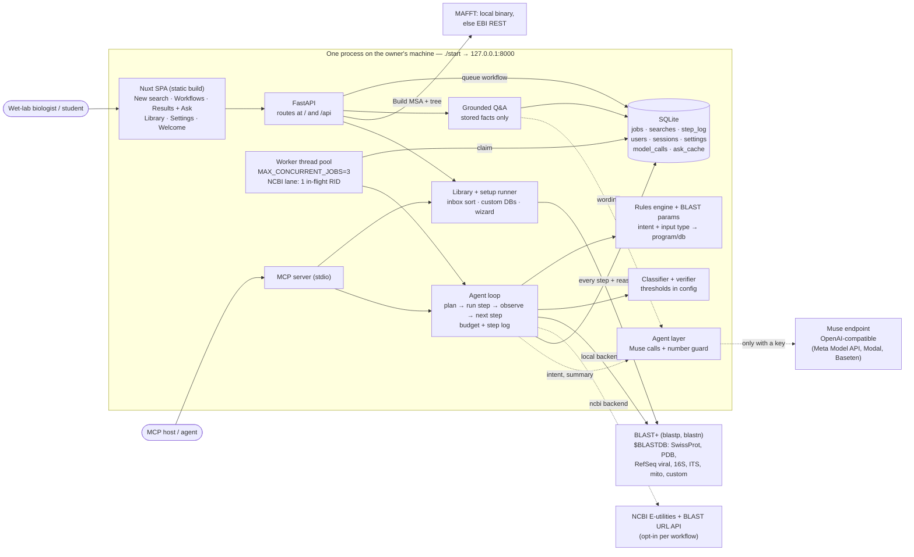
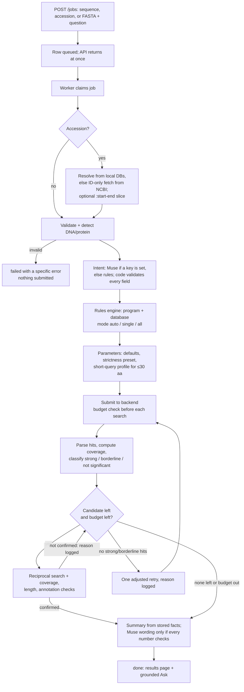

# WhatsGene — Architecture

> Design phase of the waterfall (see [docs/README.md](README.md)). Requirements: [PRD.md](PRD.md) v0.3. Science: [blast-rules.md](blast-rules.md). This file describes the system **as built** for submission on 4 Nov 2026. The design signed off on 29 Oct was WhatsApp-first with NCBI web BLAST only. The changes from that design are listed in the [PRD change table](PRD.md#changes-after-sign-off).

## Overview

WhatsGene is **delegate-and-verify** BLAST. The user asks once on a web page. The backend runs the whole multi-step workflow itself: validate, plan, search, classify, verify, retry or stop. It then returns a verified verdict with every number traceable to a stored tool run.

It is a **local tool**. One Python process on the owner's machine serves the website and the API on one address. It runs BLAST+ against databases on the same disk and keeps every workflow in one SQLite file. Remote services (NCBI, EBI, the Muse endpoint) are used only when a user opts in, and the results page labels each one.

The core rule from PRD §3 holds everywhere: **the model interprets and explains; code computes and classifies.**

## System diagram



Solid lines run offline. Dotted lines are opt-in network calls.

## Workflow lifecycle

Job states: `queued → running → done | failed | cancelled`. Outcomes: `confirmed`, `not_confirmed`, `incomplete_budget`. A job that runs out of budget ends `done` with an incomplete outcome, never a silent failure.



Rules the loop follows:

- **Budget:** `MAX_SEARCHES_PER_JOB=6` and `MAX_JOB_SECONDS=1800`. Every search counts, including reciprocal checks and retries.
- **Fan-out (`all`):** runs every program that fits the query type. A program the chosen backend cannot run is stored as a failed search with its reason. The workflow continues.
- **Deviation:** the model may propose a different program or database with a reason. It is logged and shown, and applied only when `DEVIATION_AUTO_APPLY=true`.
- **Step log:** every step writes an observation, a decision, and a reason. The results page renders it as is.

## Model vs deterministic code

| Step | Owner |
|---|---|
| Input validation, DNA/protein detection, accession resolution | Code |
| Free-text question → structured intent (goal, organism, open points) | **Muse** proposes; code validates; rules fallback |
| Intent + input type → program and database | Rules engine |
| Parameters, including the NCBI short-query profile | Code (`blast_params.py`) |
| Submit, poll, parse, coverage from coordinates | Code (search backend) |
| Classification and verification | Code; cut-offs from config or the owner's validated Settings |
| Next step: next candidate, retry, or stop | Agent loop rules over classified facts |
| Plain-language verdict | **Muse** writes it from stored facts; the number guard rejects any number not in the facts, and the code-written summary is used instead |
| Follow-up answers (Ask) | Code finds the stored facts; **Muse** words them under the same number guard; the page labels each answer Muse or stored |
| Setup assistant in Settings | **Muse** explains the plan; code runs and checks every step |
| File sorting proposals, MCP tool use | An MCP host's model proposes; code copies, builds, searches |

Every Muse call has a deterministic fallback, a 20 s timeout inside a workflow, and a row in `model_calls`. Ask also has a per-user daily quota, an answer cache, and a kill switch (`MODEL_ASK_ENABLED`).

## Components

| Module | Job |
|---|---|
| `main.py` | FastAPI app. Every route at `/` and `/api`; an `Accept`-header middleware serves the SPA to browsers on the same paths. |
| `worker.py` | Thread pool for parallel workflows; a separate one-thread lane for NCBI. Runs in-process, or as `python -m app.worker`. |
| `agent_loop.py` | The workflow: resolve, validate, plan, search, classify, verify, retry, summarise. |
| `rules_engine.py`, `blast_params.py`, `intent.py` | Program and database choice; exact parameters; rules-based intent. |
| `validate.py`, `classify.py`, `verify.py` | Input checks; significance classes; reciprocal, coverage, length, annotation checks. |
| `search_backend.py` | `LocalBlast` (default), `NcbiRemote` (opt-in), `Fixture` (tests). Local database catalog, organism scoping by seqidlist. |
| `msa.py` | Homolog collection, MAFFT (local or EBI), complete deletion, Poisson distance, NJ tree as Newick. |
| `qa.py`, `agent.py`, `model_client.py` | Grounded answers; Muse prompts and number guard; minimal OpenAI-compatible client. |
| `auth.py`, `settings.py` | Accounts, sessions, owner-browser checks; per-user profile, presets, cut-offs, Muse key, setup assistant. |
| `library.py`, `setup_runner.py`, `mcp_server.py` | Inbox inventory and confirmed sorting, custom databases; setup wizard; MCP tools over stdio. |
| `chat.py`, `whatsapp_client.py` | WhatsApp webhook and notify. Kept, deferred. |
| `frontend/` | Nuxt 3 SPA. `app` build is the tool; `landing` build is the download page only. |

## Search backends

| Backend | Programs | Databases | Data leaves the machine? |
|---|---|---|---|
| `local` (default) | `blastp`, `blastn` | SwissProt (575k), `pdbaa`, `refseq_viral_protein`, `refseq_viral_genomic`, `16s_rrna`, `fungi_its`, `mito_genomic`, and custom databases built in the app | No |
| `ncbi` (per workflow) | All five, via the BLAST URL API | NCBI's own | Yes, the sequence goes to NCBI. Submits ≥10 s apart, one in-flight RID, polls ≥60 s apart, abort after 30 min. |
| `fixture` | Recorded responses | Textbook cases | No; tests only |

A user may name a local database per workflow. The rules engine then adapts the program to the database type, or fails with a reason. It never falls back silently.

## Data model

SQLite, one file at `DATABASE_PATH`. Workflow IDs are unguessable. Every web job carries `user_id`, and every route serves only the caller's jobs.

- **jobs:** input (`raw_input`, `sequence`, `accession`, `detected_type`, `query_length`), question and `intent`, `workflow_mode`, `requested_program` / `requested_database`, `backend_choice`, primary `program` / `database` / `parameters` / `hits`, `status`, `outcome`, `searches_used`, `deadline_at`, `summary`, `error`, MSA output (`homologs`, `msa_alignment`, `tree_newick`), owner `user_id`, snapshots of `strictness` and `cutoffs`.
- **searches:** one row per BLAST run (`primary`, `reciprocal`, `retry`), with exact `parameters`, `rid`, `status`, parsed `hits`, `error`.
- **step_log:** `seq`, `step`, `observation`, `decision`, `reason`, deviation flag and reason.
- **users, sessions:** PBKDF2-SHA256 password hashes; random session tokens in an HttpOnly cookie.
- **user_settings:** per-user profile (lab name, default organism and backend, strictness, cut-offs, Muse key stored write-only).
- **usage, model_calls, ask_cache:** daily quotas; a log of every model call; cached Ask answers.

## Auth

- **First run:** with no account, the site opens `/welcome` and the owner picks a username and password. Only the browser on the same machine may do this.
- **`AUTH_MODE=single`** (written by `./start`): while the owner is the only account, the owner's browser is signed in automatically. A request counts as that browser only if it passes four checks: loopback peer, loopback `Host`, no forwarding headers, same-site `Origin`. This blocks CSRF, DNS rebinding and local tunnels.
- **More people:** the owner adds accounts in Settings, or members sign up when `ALLOW_SIGNUP=true`. Each person sees only their own workflows.

## Deployment shapes

| Shape | How | Notes |
|---|---|---|
| One Box (standard) | `./start` | Builds the venv and SPA on first run, binds `127.0.0.1:8000`, opens the browser. The setup wizard downloads and builds SwissProt. |
| Lab network | `./start --share` | Binds `0.0.0.0` over plain HTTP. For a trusted network only. |
| Private HTTPS server | `docker compose up -d --build` | Caddy (TLS) → Nuxt + FastAPI. Forces `AUTH_MODE=multi`, sign-up off, secure cookies. See [HOSTING.md](HOSTING.md). |
| Landing page | Nuxt build with `NUXT_PUBLIC_SITE_MODE=landing` | Static download page, no backend calls. |

## Failure handling

| Failure | Behaviour |
|---|---|
| Invalid input | Rejected before any search, with an error that names the problem. |
| Accession not in local databases | ID-only fetch from NCBI, labelled on the results page; otherwise a clear failure. |
| Program or database the backend cannot run | Stored as a failed search with the reason; the rest of the workflow continues. |
| Empty or weak results | One adjusted retry with the change logged, then a "no significant hit" report with the settings tried. A weak hit is never presented as an identification. |
| Budget exhausted | Stops; reports what was found and what was not; outcome `incomplete_budget`. |
| NCBI queue slow or failing | Polite polling and backoff; aborts after 30 min with the reason in the step log. |
| Muse failure, timeout, or ungrounded number | Code-written summary or answer, labelled as such. Never a 500, never an invented value. |
| No local database yet | The tool still opens; Settings shows what is missing, and the wizard builds it. |

## Verification

`backend/tests/` holds 205 offline tests on recorded fixtures, plus the classifier checks in `backend/app/tests/`. They cover the PRD eval cases (beta globin vs nematodes, insulin vs *C. elegans*, RBP4 vs CG8 false positives) and the Lab 04 short query. They also cover the CDS subrange, the agent loop, auth, settings, the library, the setup runner, local mode, and the model guardrails. The tests check behaviour, not exact hit names, because databases drift.

```bash
cd backend && .venv/bin/python -m unittest discover -s tests
```
