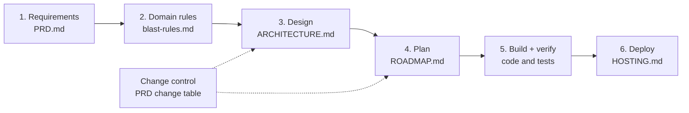

# WhatsGene docs

WhatsGene was built in a waterfall process. Each phase produced a document. The next phase started only after that document was signed off. When a requirement changed during the build, the change was logged in the PRD change table. The signed-off document was not rewritten.

| Phase | Document | What it fixes |
|---|---|---|
| 1. Requirements | [PRD.md](PRD.md) | Users, problem, scope tiers, success criteria. Baseline v0.3, 29 Oct 2026. |
| 2. Domain rules | [blast-rules.md](blast-rules.md) | The science: program choice, parameters, significance cut-offs, verification. Code follows this file; prompts never hold a threshold. |
| 3. Design | [ARCHITECTURE.md](ARCHITECTURE.md) | Components, data flow, data model, model-vs-code split, failure handling, as built. |
| 4. Plan | [ROADMAP.md](ROADMAP.md) | Dated phases with a "done when" for each, and what was delivered. |
| 5. Build + verify | `backend/tests/` | 205 offline tests, including the eval harness on the textbook cases from the PRD. |
| 6. Deploy | [HOSTING.md](HOSTING.md) | One Box local run, lab sharing, and an optional HTTPS server with Docker. |
| Change control | [PRD.md → Changes after sign-off](PRD.md#changes-after-sign-off) | Each change request: the PRD section, what it said, what it became. |

Read the PRD first. Its change table at the end shows what was asked for and what changed.
